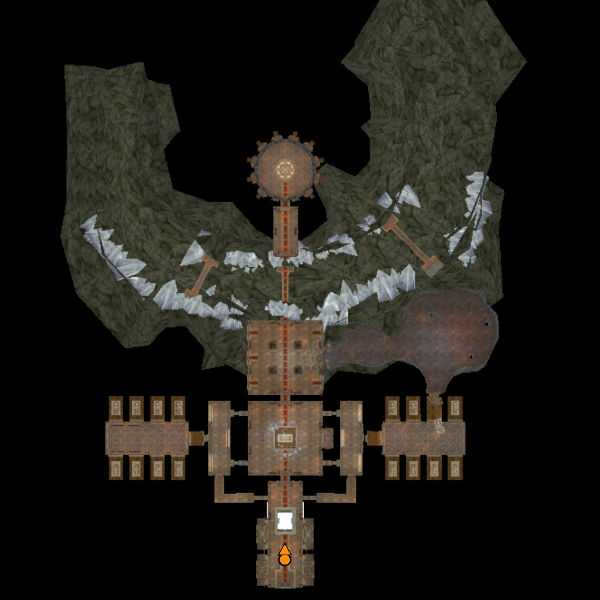
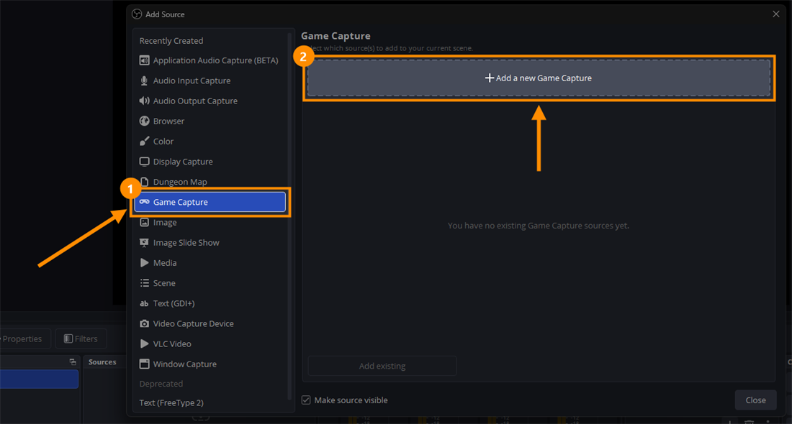
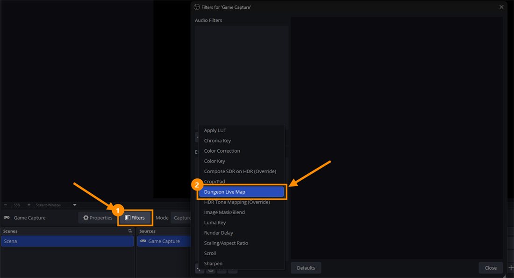
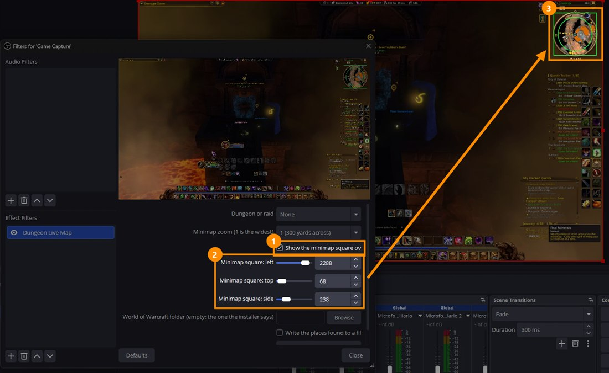
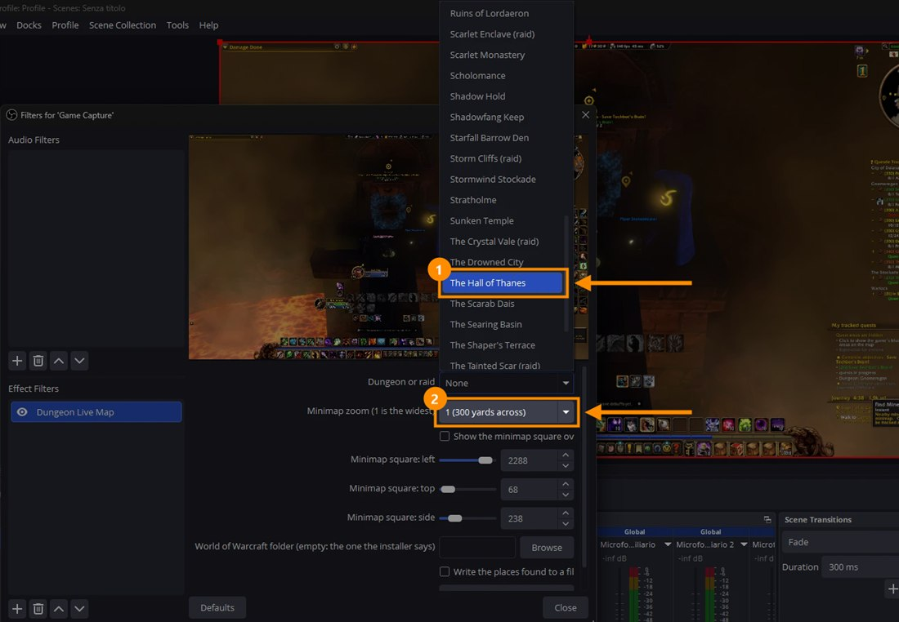
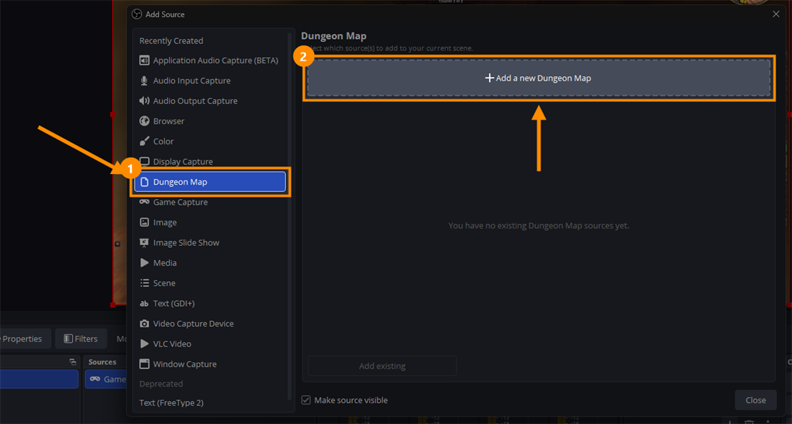
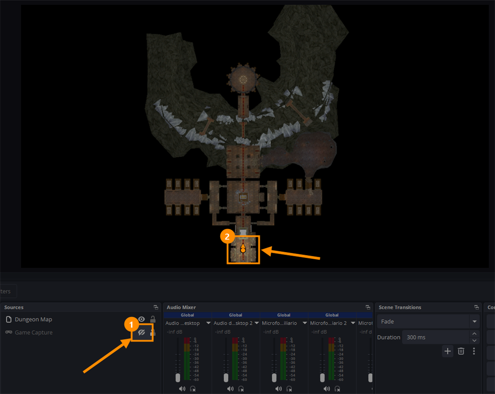
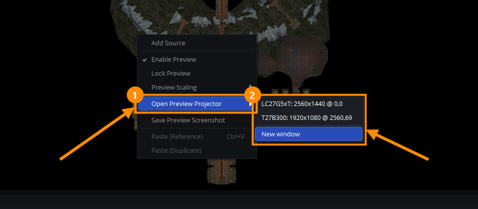

<p align="center">
  <picture>
    <source media="(prefers-color-scheme: dark)" srcset="docs/images/lockup-dark.png">
    
  </picture>
</p>

An OBS Studio plugin that shows where your character is inside a dungeon or a raid of WoW: Forever, on a live map, by reading the minimap from the game capture.

<p align="center"></p>

## Everything happens inside OBS

> [!IMPORTANT]
> **All the work is done inside the OBS process (`obs64.exe`):** cutting the minimap out of the capture, matching it against the rooms, following the character, drawing the map.
>
> **The plugin never opens the game's process, never reads or writes its memory, sends no input, and uses no network.**

### For the game, it is the same as streaming or recording

The frames come from OBS's own *Game Capture* source. To work, that source loads OBS's graphics hook into the game: the same hook every streamer and every recording made with Game Capture already has, with or without this plugin. The filter works downstream, on a picture OBS already holds. From the game's side there is no difference between this plugin and a stream on Twitch.

### What the plugin touches, and what it never does

| | |
|---|---|
| **The game's process** | Never. No memory read or written, no code injected by the plugin, no input sent. |
| **The frames** | Taken from OBS's Game Capture, exactly as for any stream or recording. |
| **The network** | Never used. |
| **The game's files** | Read only. The rooms are laid once per build of the game, from its archive (CASC) and its cache of keys; after that only `.build.info` is read, to tell which build is installed. Nothing is ever written in the game's folder: the plugin's own data goes to OBS's config folder. |
| **The Windows registry** | Read only, to find where the game is installed. |

## How it works

- A filter goes on the source that captures the game. You mark once where the minimap is.
- You pick the dungeon from a list before going in.
- Twice a second the filter cuts the minimap out of the captured frame and looks for that picture among the rooms of the dungeon. Where it fits is where you are.
- A source draws the map of the dungeon with a dot and an arrow where you are. When the minimap matches no place, the dot goes: it does not guess.
- The maps are built from your own game files, read only, the first time the plugin meets a build of the game. Nothing from the game is shipped with the plugin.

## Requirements

- Windows 10 or 11, 64 bit.
- OBS Studio 31 or later.
- World of Warcraft: Forever installed with the Battle.net app.

## Install

1. Close OBS.
2. Copy the folder `obs-forever-dungeon-live-map` into `C:\ProgramData\obs-studio\plugins\`, so that you have:
   - `C:\ProgramData\obs-studio\plugins\obs-forever-dungeon-live-map\bin\64bit\obs-forever-dungeon-live-map.dll`
   - `C:\ProgramData\obs-studio\plugins\obs-forever-dungeon-live-map\data\locale\en-US.ini`
3. Start OBS.

## Set it up

1. **Capture the game.** Add a *Game Capture* source for WoW: Forever, if you have none yet.

   

2. **Add the filter.** Select the game capture and click *Filters* (or right click it, *Filters*), then **+** under *Effect Filters* and choose *Dungeon Live Map*. The first time, the plugin lays the rooms of every dungeon from your game files: it takes some seconds, and the dungeon list fills in once it is done (close and open the filter's properties again).

   

3. **Mark the minimap.** In the filter, tick *Show the minimap square over the game*. A green square and ring appear over the game in the filter's preview. Move the sliders *left*, *top* and *side* until the sides of the square touch the round minimap. Then untick the box.

   

4. **Pick the dungeon and the zoom.** Choose the dungeon or raid from the list. Keep the minimap at its widest zoom in the game and choose zoom *1* in the filter: the other zooms are not measured yet.

   

5. **Add the map.** In your scene, add a *Dungeon Map* source, and scale and place it as you like. It follows the first Dungeon Live Map filter by itself.

   

6. **Hide the game if you want the map alone.** Turn off the eye of the game capture in the scene, but keep it there: the map keeps it running out of sight.

   

Go into the dungeon: the dot follows you. Change the dungeon in the filter before entering another one.

If the plugin does not find the game, set *World of Warcraft folder* in the filter to the folder that holds `_forever_`.

### Keep the map to yourself

The map does not have to go on stream. To see it only on your own screen, right click OBS's preview, choose *Open Preview Projector*, then a second monitor for a full screen map, or *New window* for a window you can place anywhere. With the game capture hidden (step 6) the projector shows the map alone, and nothing goes out unless you start streaming or recording.



## Build

Windows, Visual Studio 2022 or later with the C++ tools, CMake 3.28 or later:

```
cmake --preset windows-x64
cmake --build --preset windows-x64
```

The first configure downloads and builds the OBS sources it needs (a few minutes).

## Status

Works in the dungeons tried so far, at the widest zoom of the minimap. Not released yet.

## License

GPL-3.0-or-later. The minimap matching and the reading of the game files come from [Twinmap Forever](https://github.com/catubba/twinmap-forever).

Not affiliated with or endorsed by Blizzard Entertainment.
